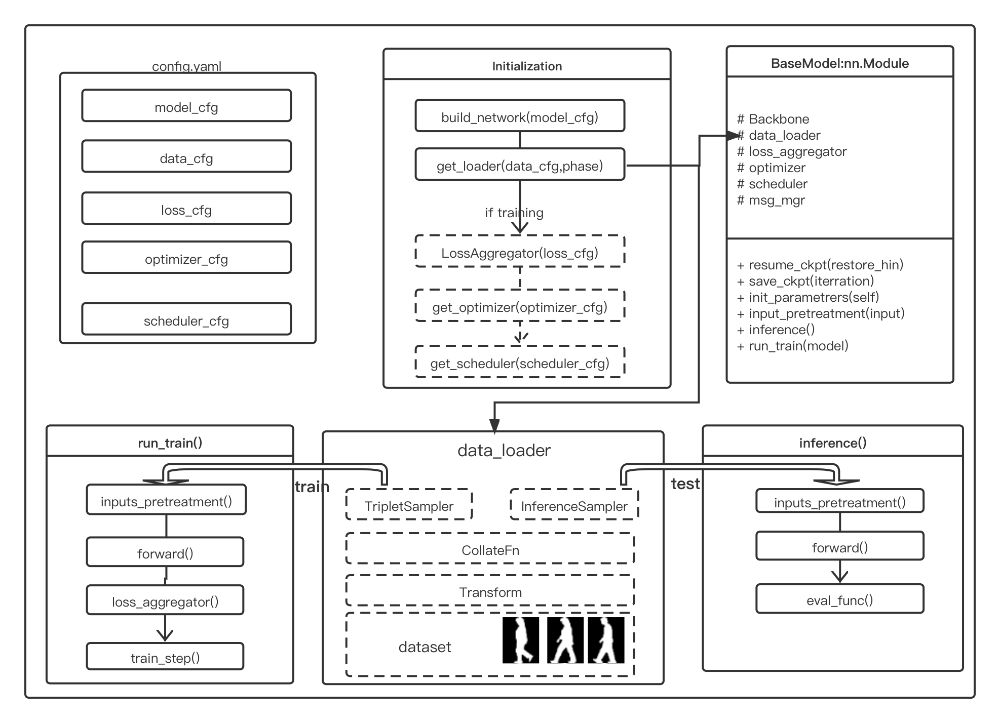

# SimpleGait

<p align="center">
  
</p>

This repository provides the code and supporting resources for **SimpleGait**, a lightweight multimodal framework for gait recognition under clothing variation and modality degradation.

> **Paper status:** Under review. This repository is made available to support code access and reproducibility during peer review.

## Repository Contents

| Directory | Description |
| --- | --- |
| [`opengait/`](opengait/) | SimpleGait implementation and training/evaluation framework (based on OpenGait). |
| [`configs/simplegait/`](configs/simplegait/) | Model configuration files for **CSCZED**, **SUSTech1K**, and **Gait3D**. |
| [`data augmentation/`](data%20augmentation/) | Data augmentation code, including **Skeleton-Guided Smart Occlusion (SGSO)**. |
| [`datasets/CSCZED/`](datasets/CSCZED/) | CSCZED train/test protocol and dataset access application form. |

## Model Configurations

Configuration files are available for the three evaluated datasets:

- [CSCZED](configs/simplegait/CSCZED/SimpleGait.yaml)
- [SUSTech1K](configs/simplegait/SUSTech1K/SimpleGait.yaml)
- [Gait3D](configs/simplegait/Gait3D/SimpleGait.yaml)

Update the dataset paths and other environment-specific settings in the YAML files before running experiments. The CSCZED configuration also provides options for different feature-fusion variants.

## Training and Evaluation

The project uses the OpenGait training framework. For example, to run the CSCZED configuration with two GPUs:

```bash
# Training
CUDA_VISIBLE_DEVICES=0,1 python -m torch.distributed.launch --nproc_per_node=2 \
  opengait/main.py --cfgs configs/simplegait/CSCZED/SimpleGait.yaml --phase train

# Evaluation
CUDA_VISIBLE_DEVICES=0,1 python -m torch.distributed.launch --nproc_per_node=2 \
  opengait/main.py --cfgs configs/simplegait/CSCZED/SimpleGait.yaml --phase test
```

Adjust the GPU count and configuration according to your setup. See the configuration files for dataset-specific settings.

## Data Augmentation

The implementation of **SGSO** and the dataset-specific augmentation scripts are provided in [`data augmentation/`](data%20augmentation/). Please refer to the [SGSO usage guide](data%20augmentation/SGSO_README.md) for instructions.

## CSCZED Dataset

**CSCZED (Cross-seasonal Clothing ZED)** is an outdoor gait dataset designed to study clothing-related condition imbalance. The dataset contains **214 subjects** and **32,447 sequences**.

- [Training/testing identity split](datasets/CSCZED/CSCZED.json)
- [Dataset access application form (PDF)](datasets/CSCZED/CSCZED_Data_Access_Application_Form.pdf)

**Dataset access:** CSCZED is available upon request, subject to a data-use agreement. Please complete the application form to request access. The full dataset is not hosted in this repository.

## Acknowledgement

This project builds upon [OpenGait](https://github.com/ShiqiYu/OpenGait). We thank the authors and contributors of the open-source gait recognition community.

## Citation

The associated manuscript is currently under review. Citation information will be updated after publication.
